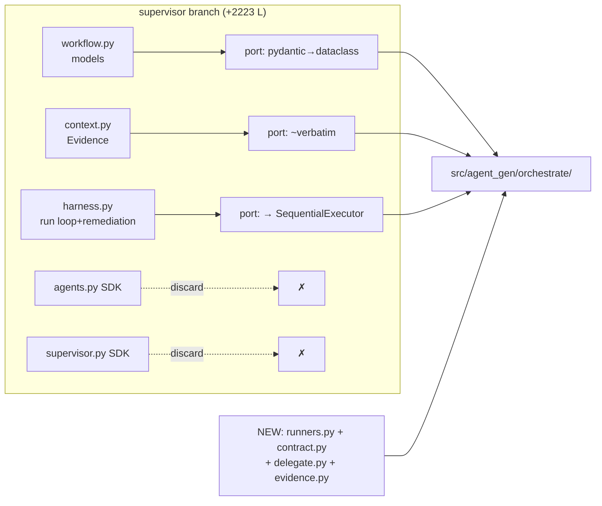
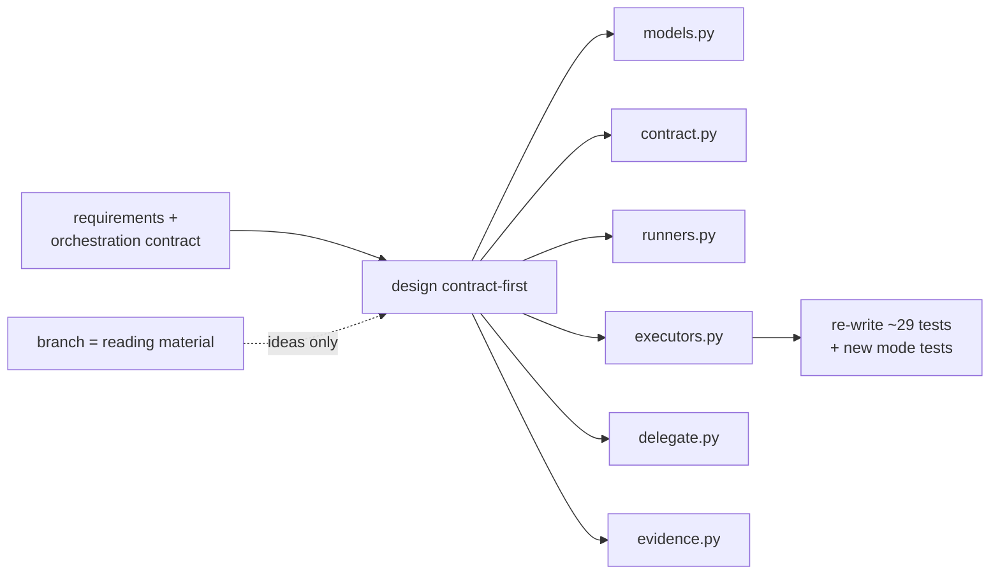
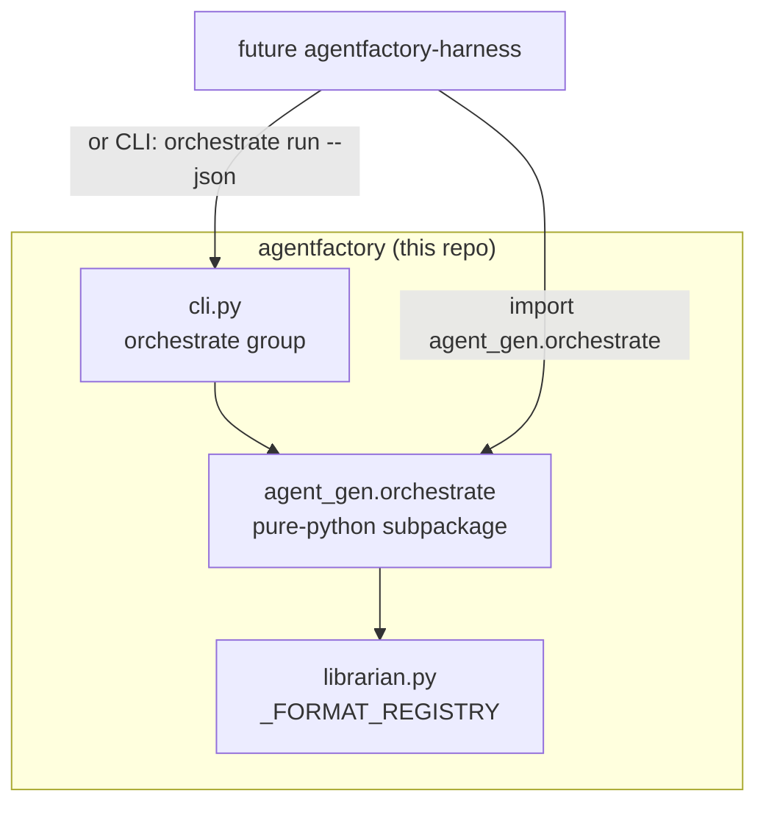
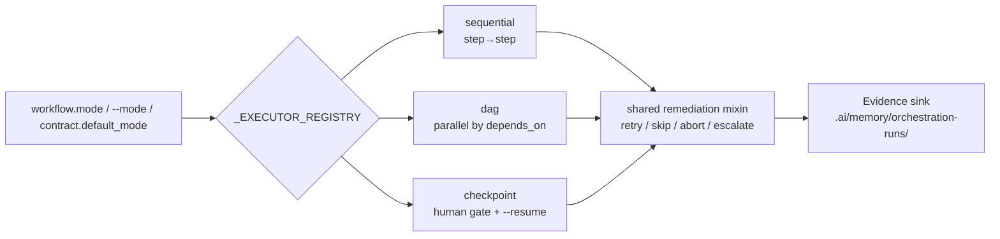
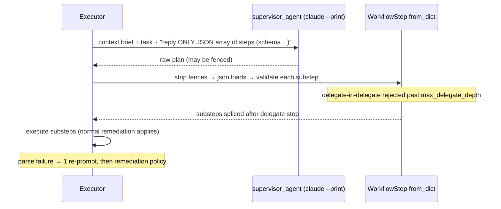

# AgentFactory Orchestration Layer — Decision Comparison + Implementation Plan
<!-- version: 1.0.0 -->

## Context

AgentFactory today **packages** agents (Portable Units) and **briefs** CLI agents (claude/codex/gemini/agy via `_FORMAT_REGISTRY`). The goal: keep all of that, and add the ability to **orchestrate those CLI agents to complete complex tasks** — usable standalone via `agentfactory-gen orchestrate …` and consumable programmatically by a future `agentfactory-harness`.

Verified facts that shape everything below:
- Core deps are only `click` + `filelock`. No pyyaml, no pydantic (api extra only), no anthropic on main.
- Non-interactive invocations already proven in `src/tests/test_cli_swap_scenarios.py:415`: `claude --print`, `codex exec --skip-git-repo-check` (+`stdin=DEVNULL`), `agy -p` (exit 0 + **empty stdout** on quota — must be treated as failure), `gemini --prompt` (retired).
- Unmerged branch `origin/claude/supervisor-agent-harness-WGnlb` (+2,223 lines, 29 tests) already implements: hub-and-spoke `Supervisor`, `Workflow`/`WorkflowStep`/`Evidence` models, `HarnessRunner` with retry|skip|abort|escalate remediation — but its workers are **Anthropic SDK calls, not CLI agents**.
- Conventions to respect: `orchestration/` is one of the 5 tracked dirs; adapter mappings already route `.claude/workflows`, `.codex/workflows`, `.agents/workflows` → `orchestration/workflows`; `agent-manifest.json` has an `orchestration_plan` field; `.ai/config/` already exists (completeness.json); CLI sub-group pattern at `cli.py:1028`.

User decisions already made: lives in this repo (harness-consumable subpackage + `orchestrate` command group) · both declarative workflows **and** supervisor/delegate steps · all execution modes selectable + extensible via an **orchestration contract** · workers = all 4 CLIs + the harness itself (nested) · **CLI-agents only, no SDK dependency**.

---

## Decision 1 — Reuse supervisor branch vs fresh implementation  ⚖️ (your comparison request)

### Option A — Reuse branch core, swap workers

Port the CLI-agnostic 60% of the branch; replace SDK workers with CLI runners.

```
src/agent_gen/orchestrate/            ← new subpackage
├── __init__.py        (public API: load_contract, load_workflow, run_workflow)
├── models.py          ← PORTED from branch workflow.py + context.py
│                        (pydantic → stdlib dataclasses; Evidence ~verbatim)
├── executors.py       ← PORTED from branch harness.py run-loop
│                        (retry|skip|abort|escalate, timeout=124, dry-run)
├── runners.py         ← NEW  CliAgentRunner replaces SDK agents.py
├── contract.py        ← NEW  .ai/config/orchestration.json
├── delegate.py        ← NEW  replaces SDK supervisor.py (claude --print planner)
└── evidence.py        ← NEW  run persistence
   [DELETED from branch: agents.py (289L SDK), supervisor.py (131L SDK)]
```



| Criterion | Assessment |
|---|---|
| Effort | **~40% less new code**; remediation loop + models proven by 29 tests (test ideas portable) |
| Deps | Zero new (pydantic re-expressed as dataclasses during port) |
| Risk | Low — semantics (escalate rounds, `Workflow.patch`, `_failure_draft`) already debugged |
| Fit | Models predate the contract concept — small impedance: `WorkflowStep` gains `type/agent/prompt/expects` fields |
| Debt | Branch can be closed with credit in CHANGELOG; one lineage |

### Option B — Fresh implementation, branch as reference only

```
src/agent_gen/orchestrate/            ← everything written new
├── __init__.py
├── models.py          ← NEW, designed contract-first (Step.type from day 1)
├── contract.py        ← NEW
├── runners.py         ← NEW
├── executors.py       ← NEW (sequential/dag/checkpoint share one abstraction from day 1)
├── delegate.py        ← NEW
└── evidence.py        ← NEW
   [branch: consulted for ideas only, stays unmerged]
```



| Criterion | Assessment |
|---|---|
| Effort | Highest — re-derives remediation/evidence semantics and their tests (~2,000+ lines incl. tests) |
| Deps | Zero new |
| Risk | Medium — subtle behaviors (escalate loops, timeout evidence, patch splicing) must be re-debugged |
| Fit | **Cleanest** — no legacy field baggage; every model shaped by the contract |
| Debt | Branch lingers as an orphan unless separately closed |

### Recommendation: **Option A (port, don't cherry-pick)**
Cherry-picking (a literal `git cherry-pick`) is the trap — it drags in `anthropic`+`pydantic` and dead SDK code. A *manual port* of `workflow.py`/`context.py`/`harness.py` into fresh files gets Option B's cleanliness at Option A's cost. The only genuinely new hard parts (contract, DAG executor, delegate JSON protocol) are new in **both** options.

---

## Decision 2 — Where it lives (decided: this repo) 🏠



Rule that keeps extraction possible later: **`orchestrate/` never imports `click` or `cli.py`** — dependency arrows only point inward (same direction as Librarian). The harness gets two stable surfaces: the Python API (`__init__.py` exports) and `orchestrate run --json` (machine-readable RunResult).

---

## Decision 3 — Workflow file format 📄

| | JSON canonical + MD wrapper (recommended) | YAML frontmatter only |
|---|---|---|
| Parser | stdlib `json` + existing flat-frontmatter parser | requires **pyyaml** (new core dep) |
| Nested steps | ✅ native | needs full YAML (existing parser is flat-only) |
| Human-readable | MD wrapper: prose + one ` ```json ` block | ✅ best |
| Version-marker rule | MD wrapper satisfies it | ✅ |
| Portable Units | both travel in `orchestration/workflows/` | same |

Canonical: `orchestration/workflows/<name>.workflow.json`. Also accepted: `<name>.md` with flat frontmatter (`name`,`version`,`description`,`mode`) + one fenced json block holding `{"steps":[…]}`. Zero new deps; matches how the repo already parses SKILL.md.

---

## Decision 4 — Execution modes (decided: all, extensible) ⚙️

Registry mirrors `_FORMAT_REGISTRY` so modes are pluggable:

```python
_EXECUTOR_REGISTRY = {"sequential": SequentialExecutor,   # PR1 (ported loop)
                      "dag":        DagExecutor,          # PR2 (toposort + ThreadPool ≤ max_parallel)
                      "checkpoint": CheckpointExecutor}   # PR2 (confirm gates + resumable state.json)
def register_executor(name, cls): ...                     # public plugin point
```



---

## Decision 5 — Orchestration contract 📜  `.ai/config/orchestration.json`

Lives beside the existing `completeness.json` (convention already established). Optional file — built-in defaults are seeded from `_FORMAT_REGISTRY`; when present it deep-merges. Per-agent `invocation` arrays are **also the test seam** (point at a stub script; no monkeypatching).

```json
{
  "version": "1.0.0",
  "default_mode": "sequential",
  "default_agent": "claude",
  "supervisor_agent": "claude",
  "agents": {
    "claude":      {"invocation": ["claude", "--print", "{prompt}"]},
    "codex":       {"invocation": ["codex", "exec", "--skip-git-repo-check", "{prompt}"], "stdin": "devnull"},
    "gemini":      {"invocation": ["gemini", "--prompt", "{prompt}"], "enabled": false},
    "antigravity": {"invocation": ["agy", "-p", "{prompt}"]},
    "harness":     {"invocation": ["agentfactory-gen", "orchestrate", "run", "{workflow}", "--json"]}
  },
  "policies": {"default_remediation": "escalate", "max_retries": 1, "timeout_seconds": 300,
               "max_remediation_rounds": 2, "max_delegate_depth": 1, "max_parallel": 4,
               "allow_shell_steps": true},
  "evidence": {"dir": ".ai/memory/orchestration-runs"}
}
```

`empty_output_is_failure` defaults **true** for all agent steps (generalizes the agy-quota lesson: an empty answer is never good evidence). The `harness` agent entry = nested orchestration (your requirement), recursion-guarded by `AGENTFACTORY_ORCH_DEPTH` env check.

---

## Decision 6 — Supervisor/delegate step (decided: CLI-agents only) 🧠



`escalate` remediation reuses the same machinery with the branch's `_failure_draft`-style prompt → replacement steps via ported `Workflow.patch()`.

---

## Workflow schema (example)

```json
{ "name": "release-check", "version": "1.0.0", "mode": "dag",
  "steps": [
    {"id": "lint", "type": "shell", "command": "ruff check src", "remediation": "retry", "max_retries": 2},
    {"id": "summarize", "type": "agent", "agent": "claude",
     "prompt": "Summarize:\n{steps.lint.stdout}", "depends_on": ["lint"], "expects": "nonempty"},
    {"id": "fix-plan", "type": "delegate", "prompt": "Plan fixes for:\n{steps.summarize.stdout}",
     "depends_on": ["summarize"]}]}
```

`type: shell|agent|delegate` · `expects: nonempty|json|regex:<p>` (violation → synthetic exit 125 → remediation) · `{steps.<id>.stdout}` templating via `string.Formatter`, truncated ~8k chars.

---

## Implementation — 4 stacked PRs

**PR1 — core + sequential** (`feature/orchestrate-core`)
- Create `src/agent_gen/orchestrate/{__init__,models,contract,runners,evidence,executors,delegate}.py` — port `workflow.py`+`context.py`→`models.py`, `harness.py` loop→`SequentialExecutor`; `delegate.py` = stub raising NotImplementedError.
- `cli.py`: `@cli.group("orchestrate")` (pattern of `adapter_group` :1028) with `run/validate/list/init`; `_echo` quiet support.
- Move provider-error markers to `runners.PROVIDER_ERROR_MARKERS`; import in `test_cli_swap_scenarios.py`.
- **Export this decision doc** → `docs/DECISIONS-ORCHESTRATION.md` (this file's Decision sections, version-marked) so the comparison is versioned in-repo.
- Tests: `test_orchestrate_models/runners/cli.py` + conftest `fake_agent` fixture (stub python script wired via contract invocation override; modes: echo/empty/provider-error/sleep/exit-N).

**PR2 — dag + checkpoint** (`feature/orchestrate-modes`)
- `DagExecutor`: Kahn toposort, cycle detection surfaced in `validate`, `ThreadPoolExecutor(max_parallel)`, failed dep → dependents `blocked`.
- `CheckpointExecutor`: injected confirm-callback (executor stays click-free), `state.json` via `filelock`, `orchestrate run --resume RUN_ID`.

**PR3 — delegate + nested harness** (`feature/orchestrate-delegate`)
- Implement `delegate.py` (diagram above), escalate remediation, `harness` runner + `AGENTFACTORY_ORCH_DEPTH` guard.
- Tests: fenced/invalid/valid JSON plans from fake agent; depth limits; nested run.

**PR4 — Portable Units + live** (`feature/orchestrate-integration`)
- `Librarian.audit()`: `invalid_workflows` report key (warning block, cli.py pattern :549); `orchestration_plan` auto-set prefers `*.workflow.json` (librarian.py:782).
- `test_orchestrate_live.py`: 1-step agent workflow per adapter, `@pytest.mark.live`, reuse skip-on-provider-error pattern.
- `docs/orchestration.md`, README section, CHANGELOG, milestones.md rows (new ORCH-1..4), version markers everywhere.

**Branch base**: stack on `feature/antigravity-cli-adapter` (PR #181) since runners use the 4-adapter registry; note merge order #177 → #181 → these.

## Key files
- `src/agent_gen/orchestrate/` (new subpackage — the harness-consumable API)
- `src/agent_gen/cli.py` (orchestrate group; audit wiring)
- `src/agent_gen/librarian.py` (`_FORMAT_REGISTRY` reuse, `orchestration_plan`, audit key)
- Port sources: `origin/claude/supervisor-agent-harness-WGnlb:src/agent_gen/supervisor/{workflow,context,harness}.py`
- `docs/DECISIONS-ORCHESTRATION.md` (exported comparison, PR1)

## Verification
1. Unit: `pytest src/tests/test_orchestrate_*.py` — every executor mode, remediation policy, contract merge, expects-validation, via the fake-agent stub (no live CLIs, no network).
2. E2E dry: `agentfactory-gen orchestrate init && orchestrate validate <example> && orchestrate run <example> --dry-run` in a temp project.
3. E2E live (claude works today): 2-step workflow (shell → claude summarize) and inspect `.ai/memory/orchestration-runs/<ts>/run.json` evidence.
4. Nested: workflow with a `harness`-agent step running a child workflow; assert depth guard.
5. Full suite green (`326+ passed`), coverage ≥80% on new subpackage.

## Risks
- Delegate-authored shell steps → gated by `allow_shell_steps`, checkpoint mode recommended for delegate workflows, audit warns.
- Quota-limited workers → empty-output/provider-marker ⇒ exit-125 evidence, never silent success.
- Parallel evidence races → per-step files, RunResult assembled single-threaded.
