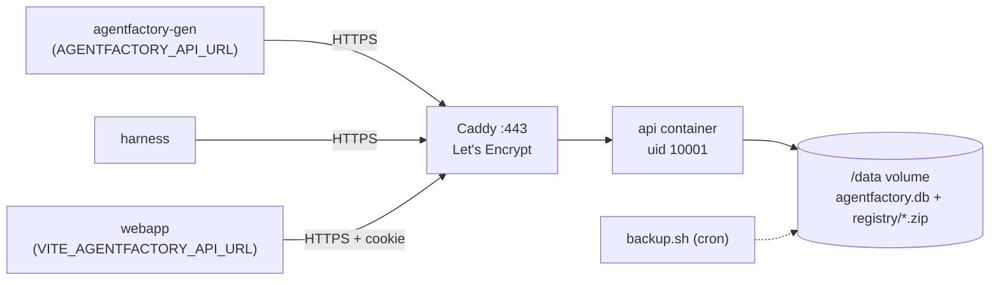

# Deploying the AgentFactory API
<!-- version: 1.0.0 -->

The API (`agentfactory-api`: auth, license, registry, device login) runs as one container with its SQLite database
and registry ZIPs on a `/data` volume. Two supported setups:

| Setup | Use it for | Files |
|---|---|---|
| **Local stack** | development, the MVP walkthrough, demos | `scripts/e2e-local.sh`, `docker-compose.yml` |
| **Single VPS** | the public API (`https://<API_DOMAIN>`) | `deploy/vps/` (API + Caddy with automatic HTTPS) |



## Local stack

```bash
python3 -m venv .venv && .venv/bin/pip install -e ".[dev,api]"
PATH=$PWD/.venv/bin:$PATH scripts/e2e-local.sh --keep    # API on :8765 + the full MVP walkthrough
```

`--keep` leaves the API running on all interfaces and prints the exact webapp command. In short:
`cd ../agentfactory-webapp && VITE_AGENTFACTORY_API_URL=http://localhost:8765 npm run dev -- --host`, then
<http://localhost:5173/AgentFactory/registry>. On WSL2 with a Windows browser, `--host` is required; if `localhost`
still resets the connection, use the WSL IP (`hostname -I`) for both URLs.

GitHub sign-in (and the `/device` approval page) needs a GitHub OAuth App even locally. Without one, create a local
account and token instead:

```bash
agentfactory-api users add --github-handle me
agentfactory-api tokens add --github-handle me > ~/.agentfactory/token && chmod 600 ~/.agentfactory/token
```

## Single VPS

Requirements: a Linux server with Docker Engine + Compose v2, ports 80/443 open, and a DNS record for `API_DOMAIN`
pointing at it.

1. **GitHub OAuth App:** github.com/settings/developers → *New OAuth App*.
   - Homepage URL: the webapp URL.
   - Authorization callback URL: `https://<API_DOMAIN>/auth/github/callback`.
2. **Server:**
   ```bash
   sudo mkdir -p /opt/agentfactory && sudo chown $USER /opt/agentfactory
   git clone https://github.com/matheusmlopess/AgentFactory.git /opt/agentfactory
   cd /opt/agentfactory/deploy/vps
   cp .env.example .env && chmod 600 .env && $EDITOR .env    # domain, JWT_SECRET, OAuth app, webapp URL
   docker compose up -d --build
   curl https://<API_DOMAIN>/health                          # {"status":"ok"}
   ```
   Caddy obtains the certificate on the first request. Never set `AGENTFACTORY_ENV` in production.
3. **Clients:** `export AGENTFACTORY_API_URL=https://<API_DOMAIN>` (CLI and harness) and
   `VITE_AGENTFACTORY_API_URL=https://<API_DOMAIN>` (webapp build). Then `agentfactory-gen login`.
4. **Backups:** `./backup.sh` writes `backups/agentfactory-<UTC>.tar.gz` (online SQLite backup + registry ZIPs) and keeps
   the newest 14. Schedule it with cron and copy `backups/` off the server.

### Operations

| Task | Command (in `deploy/vps`) |
|---|---|
| Upgrade | `git pull && docker compose up -d --build` |
| Logs | `docker compose logs -f api` |
| Issue a license key | `docker compose exec api agentfactory-api keys add --plan pro` |
| Revoke a CLI token | `docker compose exec api agentfactory-api tokens revoke <token>` |
| Rotate `JWT_SECRET` | edit `.env`, `docker compose up -d` (signs everyone out of the webapp; CLI tokens keep working) |
| Restore | `docker compose stop api`, extract the backup into the `api_data` volume (`backup.db` → `agentfactory.db`, `registry/`), `docker compose start api` |

### What was verified (2026-11-16)

The stack ran end to end on Docker 29.9 with `API_DOMAIN=localhost` (Caddy internal CA):
- HTTPS `/health` and `/registry` respond, with HSTS and `nosniff` headers.
- A publish over HTTPS returns `zip_url` on the domain.
- `backup.sh` captured the database and the ZIP.
- Data survived an API restart.
- The API runs as uid 10001.
